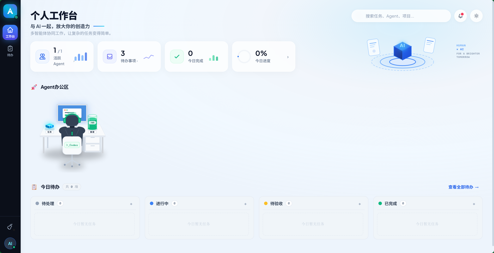
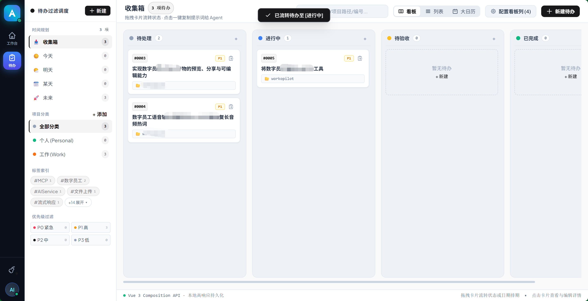
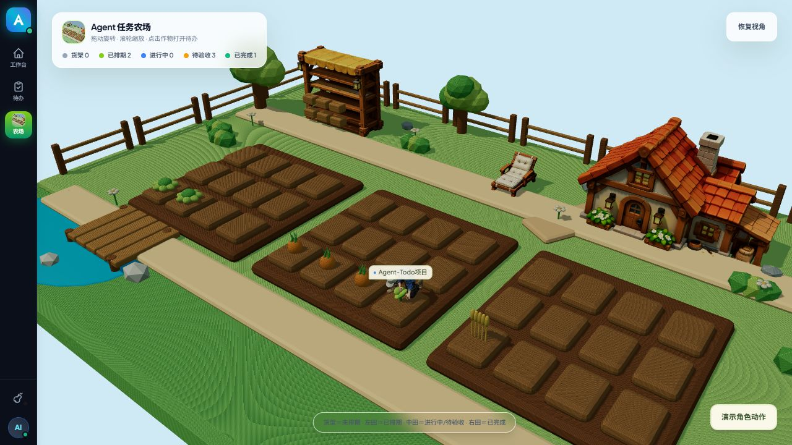

# Agent Todo

English · [简体中文](README.md)

A local-first todo skill for Codex. It stores personal or workspace tasks in SQLite and provides a web dashboard for todos, Codex quota, and current activity.

## Features

- Create, retrieve, update, and complete todos through natural language.
- Default a newly created todo to the current local date when no date is supplied.
- Assign stable four-digit codes and use optimistic concurrency for safe updates.
- Store all todo data locally in SQLite with no external database.
- Generate one `project-feature` tag by default instead of attaching a pile of overlapping tags.
- Use the fixed local address `http://127.0.0.1:8021/`; the first operation starts and opens the dashboard automatically, while a running service does not open another browser tab.
- Sync todos and Codex activity every five seconds while visible, with an immediate refresh when the page regains focus.
- Show one Codex workstation with a row for every current parallel task, plus a weekly todo board below it.
- Provide a dedicated 3D task farm: the stall holds unscheduled tasks, the left field holds scheduled tasks, the middle field holds active/review tasks, and the right field holds completed tasks.
- Move the character into the field with a digging animation while Codex is working, and back to the chair while idle. Hover crops for titles and click them to open todo details.
- Render running tasks with a blue light stream, user-confirmation waits in orange, and completed unread tasks in green.
- Read quota from the local Codex `app-server` and infer activity from local session events.
- Run on Windows, macOS, and Linux without third-party npm runtime dependencies.

> Status is read-only. Approvals, confirmations, and user input must still be handled in Codex.

## Screenshots

### Personal workspace



### Todo board



### 3D task farm

The character uses native Tripo walk, sit, dig, and dance animations. When Codex starts working, it rises from the chair, walks into a field cell, and digs up a plant labeled with the session title. After work finishes, it walks to a random roadside spot, dances, and returns to sit. Click a plant or its floating title to open the Codex thread. Use the bottom-right action preview to try the full sequence without changing any tasks.

Each session owns a distinct stable cell. The farmer randomly visits concurrent unfinished sessions: short plants indicate active work, tall plants indicate completion, and swaying plants indicate approval requests or problems. Walking follows a direct route; sitting and digging face the same direction as the house entrance. Compact bubbles display session titles.



## Requirements

- Codex desktop or Codex CLI
- Node.js 22.13 or newer
- Local port `8021` available

## Installation

The repository root is the complete skill directory. Reopen Codex or start a new conversation after installation so the skill can be discovered.

### SSH

macOS / Linux:

```bash
git clone git@github.com:Angus221/agent-todo.git ~/.codex/skills/agent-todo
```

Windows PowerShell:

```powershell
git clone git@github.com:Angus221/agent-todo.git "$env:USERPROFILE\.codex\skills\agent-todo"
```

### HTTPS

```bash
git clone https://github.com/Angus221/agent-todo.git ~/.codex/skills/agent-todo
```

You can also ask Codex to install this repository with `skill-installer`.

## Usage

After installation, ask Codex things like:

- “Add a high-priority todo for tomorrow afternoon.”
- “List unfinished workspace todos.”
- “Mark 0007 as in progress.”
- “Complete 0007 and save the result summary.”
- “Open the Agent Todo dashboard.”
- “Show my current Codex quota and active tasks.”
- “Open the 3D task farm.”

Before any todo command, the skill checks the web service. If it is not running, the CLI starts it on `127.0.0.1:8021` and opens the browser. If it is already running, the CLI neither starts another process nor opens another browser tab.

## CLI

Windows:

```powershell
./scripts/agent-todo.ps1 dashboard
./scripts/agent-todo.ps1 list --format text
./scripts/agent-todo.ps1 get 0007
```

macOS / Linux:

```bash
./scripts/agent-todo.sh dashboard
./scripts/agent-todo.sh list --format text
./scripts/agent-todo.sh get 0007
```

Create and update commands accept UTF-8 JSON input files. See the [database and API reference](references/schema.md) for fields and endpoints.

## Data and privacy

- The database is stored at `data/agent-todo.sqlite` by default.
- SQLite, WAL, SHM, logs, and other local runtime data are excluded by `.gitignore`.
- The web server listens only on the loopback interface and is not exposed to the LAN or internet.
- Codex quota and session status come from the local Codex service and local session files.
- Back up `data/agent-todo.sqlite` before removing the skill directory.

## Project structure

```text
agent-todo/
├── SKILL.md                 # Codex skill entry point
├── agents/openai.yaml       # Skill UI metadata
├── assets/
│   ├── screenshots/         # README screenshots
│   ├── blender/             # Blender source for the 3D farm
│   └── web/                 # Vue 3 dashboard, Three.js runtime, and GLB scene
├── data/                    # Local SQLite data (not committed)
├── references/              # Architecture, database, and API notes
├── scripts/
│   ├── cli.ts               # CLI and automatic dashboard startup
│   ├── server.ts            # Local HTTP/API server
│   ├── lib/                 # SQLite and Codex status integration
│   └── tests/               # Node.js tests
├── README.md
└── README_EN.md
```

## Development and validation

```bash
npm test
node scripts/server.ts
```

Validate the skill structure with Codex's bundled `skill-creator/scripts/quick_validate.py`.

## Acknowledgements

The quota and local session-scanning approach was informed by the MIT-licensed [itvincent-git/codex-usage-desktop](https://github.com/itvincent-git/codex-usage-desktop). This repository contains an independent TypeScript implementation.

The browser assets include builds of Vue 3, Marked, and Three.js under their original open-source licenses.

## License

[MIT](LICENSE)

